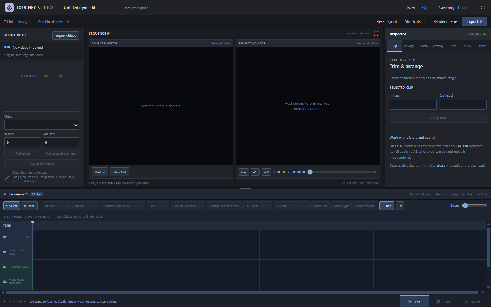

# Gym Editor Studio on Windows

The editor can open in its own desktop window, using your installed Edge,
Chrome, or Brave. The local Node server and existing converter do the rendering.
This adds no Electron runtime or separate browser download.



## Work in Journey Studio

The media pool, source monitor, project monitor, inspector and timeline share
one window. Drag the dividers to resize panels. Use **Edit**, **Audio**, and
**Deliver** at the bottom to change views; use **Reset layout** to start over.
The inspector includes clip trims, background face blur, voice mixing,
picture in picture, Remotion titles, JSON edits and final export settings.

Drop videos from Explorer into the media pool. Drag imported clips to V1 for
picture and camera sound, or A2 for sound alone. Video and camera audio align
on V1/A1. **Shift+G** unlinks them for independent deletion, and cuts/trims of
unlinked camera audio move it onto A2. **Shift+D** explicitly detaches audio.
You can keep the full audio while cutting the picture, then export one video.
Audio extending beyond the picture produces black frames for that interval.

Use **V** to select, **B** to cut by clicking, **Shift+R** to split at the
playhead, and **Delete** to remove the selected material. Drag clip edges to
trim; use **S** for snapping, **Shift+Z** to fit the timeline, and **Ctrl+Z** /
**Ctrl+Shift+Z** for undo/redo. The ruler can be dragged for scrubbing.

**Ctrl+S** downloads a `.gymedit.json` project; **Ctrl+O** opens one. A local
draft is also saved after edits, with **Recover draft** available on return.
Projects store edit decisions and file metadata, not copies of large video
files. Opening or recovering asks you to select the original media again,
including voice and overlay assets. Files can be selected in any order;
names and sizes must match. Browser draft storage belongs to that browser
profile, so use downloaded projects when switching computers or browsers.
The JSON inspector's **Download plan** creates the plain JSON format accepted
by `npm run editor:plan`; a `.gymedit.json` wrapper is opened in the editor.

**Deliver** renders the master and then the existing combined converter
outputs: TikTok 1080×1920 at 60 fps / 25 Mb/s with 2× slowdown, and Instagram
1080×1920 at 30 fps / 15 Mb/s at normal speed. **Render queue** shows progress
and downloads. Face blur still needs review on the finished file.

## Install on another machine

1. Install Git and Node.js 20 or newer.
2. Clone the repository and check out `release/editor-studio`.
3. Open PowerShell in the project folder and run `npm ci`.
4. Copy `.env.example` to `.env` if this is a new installation. Set `MEDIA_ROOT`
   to a drive with room for your 4K sources and exports. Keep an existing `.env`
   when updating a working installation.
5. Create the shortcut:

   ```powershell
   powershell -NoProfile -ExecutionPolicy Bypass -File .\scripts\create-editor-shortcut.ps1
   ```

6. Double-click **Gym Editor Studio** on your Desktop.

The shortcut uses the Windows Desktop folder, including a Desktop redirected
to OneDrive. It records this checkout's location; recreate it if you move the
project. Re-running the installer updates that one shortcut.

Automatic face detection also needs Python, OpenCV and NumPy, as described in
the main README. Manual blur regions work without that optional Python setup.
NVIDIA and AMD encoding availability depends on the machine's GPU, driver and
FFmpeg build; CPU rendering remains available.

## Launch options

Open the desktop editor directly:

```powershell
powershell -NoProfile -ExecutionPolicy Bypass -File .\scripts\start-editor-desktop.ps1
```

Choose a particular installed browser:

```powershell
powershell -NoProfile -ExecutionPolicy Bypass -File .\scripts\start-editor-desktop.ps1 -Browser brave
```

Use `edge`, `chrome`, or `brave`. Automatic selection tries Edge, Chrome, then
Brave. If no supported browser is found, the launcher opens the editor in your
default browser. You can also install a shortcut with a browser preference:

```powershell
powershell -NoProfile -ExecutionPolicy Bypass -File .\scripts\create-editor-shortcut.ps1 -Browser chrome
```

To start or verify the backend without opening a window, add `-NoBrowser` to
the launcher command. The URL normally is `http://127.0.0.1:4173/editor`; a
custom `PORT` in `.env` is honored automatically.

## Server and storage behavior

The launcher reuses a healthy local server. It never restarts that server or
interrupts active conversions. A missing server starts hidden in the background
with the project directory as its working folder, so `.env`, the media drive,
and existing Telegram configuration continue to apply.

Closing the desktop editor window leaves the backend and queued conversions
running. Open the shortcut again to return to the editor. The server still
listens only on `127.0.0.1`; opening an app window does not publish it online.

Startup errors appear in a dialog. Server output is written to
`logs/editor-desktop.log` and `logs/editor-desktop-error.log` when this launcher
starts the server. If the launcher says the port is in use, inspect the running
application before stopping anything; another converter launch may already
be using that port.

Browser app windows provide a separate taskbar entry and a compact window.
This is a local web editor hosted by the system browser. Project media remains
subject to browser file permissions, and selecting media again may be required
when restoring a project. The application does not install a Windows service
or automatically launch at sign-in.
